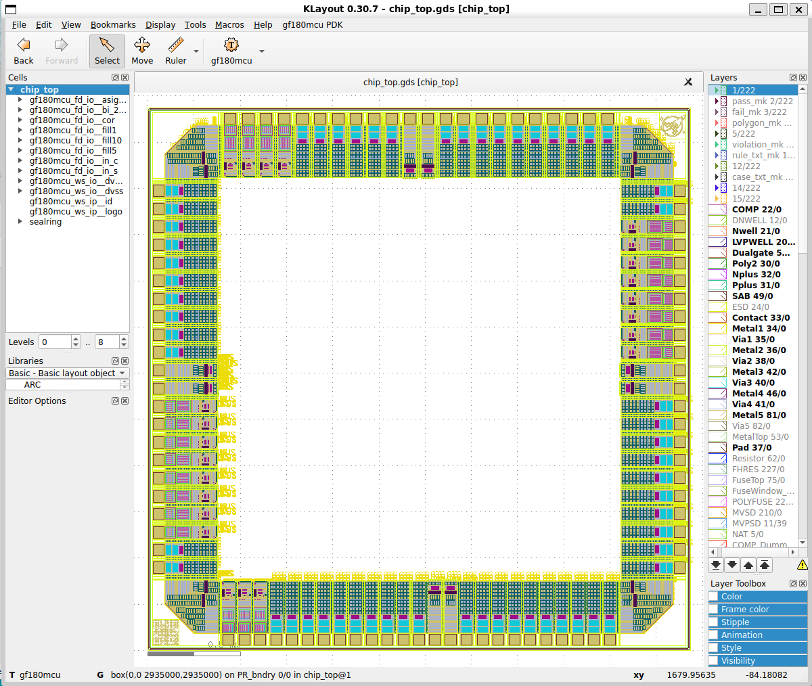

# คู่มือ GF180MCU Pad Ring ด้วย LibreLane

**Chipathon 2026 · Workshop slot · Linux / Ubuntu บน WSL2**

คู่มือนี้ใช้โครงการ `Mauricio-xx/chipathon-2026-gf180mcu-padring` เป็นแล็บสำหรับสร้างวงแหวน I/O รอบได ตรวจตำแหน่ง pad และต่อยอดไปสู่ full-chip RTL-to-GDSII ตัวอย่างใช้ counter 20 บิตเพื่อให้ติดตามเส้นทางจาก clock pad ผ่าน core ไปถึงขาออกได้ง่าย

## 1. อ่านโครงสร้างก่อนรัน

| ไฟล์ | บทบาท |
|---|---|
| `Makefile` | เลือก slot, PDK และเป้าหมาย pad ring หรือ full chip |
| `src/slot_defines.svh` | แปลง `SLOT_WORKSHOP` เป็นจำนวน I/O แต่ละประเภท |
| `src/chip_top.sv` | สร้าง I/O cell instances เชื่อมพอร์ตภายนอกกับ `chip_core` |
| `src/chip_core.sv` | counter แบบ synchronous active-low reset และสัญญาณควบคุม I/O |
| `librelane/slots/slot_workshop.yaml` | กำหนด die, core และลำดับ instance ทั้งสี่ด้าน |
| `librelane/config.yaml` | เลือก Chip flow, timing, PDN และ physical verification |
| `librelane/pdn_cfg.tcl` | สร้างกริดจ่ายไฟสำหรับ core |
| `scripts/padring.py` | Python flow สำหรับสร้างและดู pad ring ก่อนรันทั้งชิป |

ขนาด die คือ 2,935 × 2,935 µm และ core คือ 2,051 × 2,051 µm จากพิกัด `[442, 442, 2493, 2493]` จึงเหลือกรอบรอบ core ด้านละ 442 µm ก่อนคิดพื้นที่จริงของ pad, corner, seal ring และข้อกำหนด routing

| ด้าน | ลำดับรายการใน YAML | Analog | Bidir | DVDD + DVSS | Input | รวม |
|---|---|---:|---:|---:|---:|---:|
| South | SW → SE | 20 | 0 | 2 | 3 | 25 |
| East | SE → NE | 12 | 8 | 2 | 0 | 22 |
| North | NE → NW | 16 | 4 | 2 | 0 | 22 |
| West | NW → SW | 12 | 8 | 2 | 0 | 22 |
| รวม | | 60 | 20 | 8 | 3 | 91 |

ตัวเลข South นับจากรายการจริงใน YAML ซึ่งมี `inputs[0].pad` เพิ่มจาก clock และ reset ส่วน corner `gf180mcu_fd_io__cor` อีก 4 ตัวเกิดใน flow รวมเป็น 95 ตำแหน่งเมื่อรวม corner โดยยังแยก filler ออกจากจำนวนนี้ ลำดับด้านเหนือและตะวันตกกลับด้านเมื่อเทียบกับไฟล์ standalone ของ Juan Moya ให้ยึดพิกัดใน DEF เมื่อทำ bond diagram หรือ PCB pinout

## 2. เตรียมสภาพแวดล้อมและล็อกเวอร์ชัน

เอกสารโครงการใช้ Nix, LibreLane 3.0.0 และ wafer.space PDK tag 1.8.0 โดย Makefile เลือก `gf180mcuD` และโหมด manual PDK เตรียมพื้นที่ว่างประมาณ 20 GB ตามคู่มือต้นทาง สำหรับ WSL2 ให้ clone ใน Linux filesystem เช่น `~/labs` และใช้ WSLg สำหรับเปิด GUI หาก Nix แจ้งว่า flakes ยังปิด ให้เพิ่ม `experimental-features = nix-command flakes` ในการตั้งค่า Nix

```bash
mkdir -p ~/labs
cd ~/labs
git clone https://github.com/Mauricio-xx/chipathon-2026-gf180mcu-padring.git
cd chipathon-2026-gf180mcu-padring
git rev-parse HEAD
nix-shell
librelane --version
make help
make -n SLOT=workshop librelane
make clone-pdk
git -C gf180mcu describe --tags --exact-match
test -d gf180mcu/gf180mcuD/libs.ref
```

`make clone-pdk` ลบไดเรกทอรี `gf180mcu/` เดิมก่อน clone ให้ใช้กับ checkout ใหม่หรือเมื่อพร้อมแทนที่ PDK ในไดเรกทอรีนี้ หากมี PDK ที่ตรงกันอยู่แล้ว ให้ข้ามขั้น clone และส่ง `PDK_ROOT=/path/to/pdk-root` ให้ Make โดย root ต้องมี `gf180mcuD/` อยู่ข้างใน คง `SLOT=workshop` ทุกครั้ง เพราะค่าเริ่มต้นคือ `1x1`

## 3. สร้างเฉพาะ pad ring

```bash
make SLOT=workshop librelane-padring
find librelane/runs -type f \( -iname '*padring*' -o -name '*.gds' -o -name '*.def' \) | sort
```



Python flow รัน lint และ synthesis เพื่อให้ได้ instance จริง จากนั้นทำ pre-PnR STA, floorplan, ผูก power nets และเรียก `OpenROAD.PadRing` ก่อนวาง macro แบบระบุพิกัด, stream out และสร้าง seal ring หาไดเรกทอรี run จาก log แล้วเปิด GDS ของขั้น SealRing ด้วย `klayout /path/to/chip_top.gds` หรือเปิด DEF/ODB ของขั้น PadRing เพื่ออ่านชื่อ instance และพิกัด ผลลัพธ์อยู่ใน run directory ขั้นตอนนี้จบที่ seal ring ก่อน core placement, CTS, routing และ signoff

ตรวจ 4 รายการใน GUI

1. เลือก top cell `chip_top` แล้ววัด die boundary ให้ได้ 2,935 µm ต่อด้าน
2. ตรวจ corner ทั้งสี่และ orientation ของ pad footprint ให้หันตามด้านที่กำหนด
3. เริ่มจาก SW ไป SE ด้าน South ตรวจว่า clock, reset และ input เสริมอยู่สามลำดับแรก เปรียบเทียบชื่อ instance และตำแหน่งกับภาคผนวก
4. ตรวจว่าทุกด้านมี DVDD/DVSS อย่างละหนึ่ง และบันทึกตำแหน่งจริงจาก DEF แยกจากเลขลำดับรายการ เลขในตารางใช้เทียบกับ YAML ส่วนเลขขา package ต้องกำหนดตาม bonding plan

## 4. อ่านสัญญาณและไฟเลี้ยง

- `clk_PAD → clk_pad/Y → chip_core.clk` ผ่าน Schmitt input `gf180mcu_fd_io__in_s` ส่วน reset ใช้ `gf180mcu_fd_io__in_c` และ core รับ reset ที่ขอบขาขึ้น
- `bidir_PAD[19:0]` ใช้ `gf180mcu_fd_io__bi_24t` ตัวอย่างเปิด output enable ทุกบิต ปิด input enable และขับค่าตัวนับผ่าน pad บิตเดียวกัน ตรวจ pad model ก่อนเปลี่ยนเป็น bidirectional โดยเฉพาะ OE/IE และช่วง turnaround ที่บอร์ดอาจขับชนกับชิป
- Analog pad ทั้ง 60 ใช้ `gf180mcu_fd_io__asig_5p0` และยังไม่มี analog IP ใน core ชื่ออ้างอิงอย่าง `ana1` สื่อถึงตำแหน่งเดิมใน workshop โดยเทียบกับ `analog_PAD[0]` และ instance `analog[0].pad`
- Pad ไฟเลี้ยงใช้เซลล์ `gf180mcu_ws_io__dvdd` และ `gf180mcu_ws_io__dvss` ผูกกับ `VDD/VSS` ชื่ออ้างอิง analog/digital จากผังเดิมบอกตำแหน่ง ใน template นี้ให้ตรวจ power domain จาก netlist จริงก่อนออกแบบแหล่งจ่ายแยก
- ตรวจการจ่ายไฟสามระดับ ได้แก่ pin-to-net ใน powered netlist, ความต่อเนื่องทางกายภาพจาก power pads ผ่าน core ring และ straps และผลตรวจ PDN/IR drop ตัวเลือก `PDN_CORE_RING_CONNECT_TO_PADS: True` กำหนดให้ flow เชื่อม ring ไปยัง pads ส่วนผลการเชื่อมต้องตรวจจากฐานข้อมูลและรายงานหลังสร้าง PDN

## 5. รันเต็มชิป

```bash
set -o pipefail
make SLOT=workshop librelane 2>&1 | tee workshop-full.log
```

Makefile ส่ง slot YAML และ config หลักให้ LibreLane พร้อม `--manual-pdk` และบันทึก views ลง `final/` ให้รอจนคำสั่งจบสำเร็จก่อนใช้ผลลัพธ์ และเก็บสำเนา `final/` ของ baseline ก่อนทดลองเปลี่ยน RTL เพราะหลาย target ใช้ปลายทางเดียวกัน README รายงานเวลารันอ้างอิงประมาณ 2 ชั่วโมง 15 นาที ขึ้นกับเครื่องและสภาพแวดล้อม

```bash
find final -maxdepth 3 -type f | sort
klayout final/gds/chip_top.gds
make SLOT=workshop librelane-openroad
```

เปิดด้วย target `librelane-openroad` เมื่อ run ล่าสุดเป็นผลที่ต้องการ หากเพิ่งรัน pad ring ซ้ำ ให้ระบุไฟล์จาก full run ที่ต้องการใน GUI หรือเปิด GDS จาก `final/` โดยตรง

| สิ่งที่ตรวจ | หลักฐานที่ต้องเปิด |
|---|---|
| Physical placement และ routing | GDS/DEF, pad map, ตรวจ pin access และผล detailed routing |
| DRC / Density / Antenna | รายงาน KLayout และ Magic ที่มีใน run ตรวจจำนวน violation และ rule IDs เทียบกับข้อกำหนดการส่งผลิต |
| LVS | รายงาน Netgen ตรวจ top cell, pin mapping และ unmatched nets/devices |
| Timing | รายงาน STA แต่ละ corner ตรวจ setup/hold, WNS/TNS และ unconstrained endpoints |
| Power | PDN connectivity, IR-drop report, powered netlist และกรอบแรงดันของ I/O library |
| Release | `final/metrics.csv`, GDS, DEF, netlists, LEF, SPEF, SDF และบันทึกเวอร์ชัน |

Config ตั้ง `ERROR_ON_MAGIC_DRC: False` จึงต้องเปิดรายงาน Magic แม้คำสั่งจบสำเร็จ และตั้ง `GRT_ALLOW_CONGESTION: true` จึงต้องตรวจ congestion และผล detailed routing จริง ตรวจชั้นโลหะและข้อกำหนด density ตาม deck ที่ใช้ส่งงาน โดยเฉพาะตัวเลือก filler สำหรับ Metal2

## 6. ตรวจ timing และ simulation

Config กำหนด `CLOCK_PERIOD: 40` ns หรือ 25 MHz และ SDC ใช้ `clk_pad/Y` เป็นจุดสร้าง clock เมื่อ `CLOCK_NET` ต่างจาก `CLOCK_PORT` ให้ตรวจว่าจุด clock ตรงกับเจตนาว่าจะวัดจากขาในหรือจากขาภายนอก หากต้องการปิด timing ที่ระดับบอร์ด ให้กำหนด input/output delay min/max ตาม external device, skew ของบอร์ดและโหลดที่กำหนดจริง พร้อมตรวจ reset ที่ถูก sample ใน core และตรวจว่า timing report ครอบคลุมเส้นทางผ่าน I/O cells ตามที่ต้องการ

`cocotb/chip_top_tb.py` เดิมตั้ง clock 50 MHz และคาดว่า counter เริ่มเมื่อเขียน `input_PAD` จึงควรแก้ stimulus และ assertion ก่อนใช้ `make SLOT=workshop sim` หรือ `sim-gl` เป็นเกณฑ์ผ่าน ให้ตั้ง period 40 ns, ขับ reset ค้างผ่านขอบขาขึ้น, ปล่อย reset ที่ขอบขาลง แล้วตรวจค่าหลังสัญญาณนิ่งในแต่ละขอบขาขึ้น ค่าเริ่มหลัง reset คือ 0 และขอบแรกหลังปล่อย reset ได้ 1 การเปลี่ยน `input_PAD[0]` ต้องไม่มีผลต่อการนับของตัวอย่าง ใช้ GLS ตรวจว่าค่าออกผ่าน powered netlist และ pad models หลังได้ `final/pnl/chip_top.pnl.v`

## 7. ดัดแปลงเป็นชิปของตนเอง

1. เก็บผล baseline และ commit ID แล้วแก้ `src/chip_core.sv` โดยคงพอร์ตและพารามิเตอร์ที่ wrapper ใช้ หากใช้ผังเดิมให้คง 1 input เสริม, 20 bidir และ 60 analog
2. ถ้าต้องเปลี่ยนจำนวน pad ให้อัปเดต `slot_defines.svh`, RTL/top-level mapping, รายการ `PAD_*` และ testbench พร้อมกัน สำหรับชื่อจาก generate loop ใช้รูปแบบ escape ที่ repo ใช้ใน YAML และตรวจชื่อที่ synthesis ส่งต่อให้ OpenROAD
3. ถ้าเพิ่ม analog macro ให้เตรียม views ที่ตรงกันสำหรับ implementation และ verification เช่น LEF/GDS และ netlist LVS กำหนดตำแหน่ง, power domain และการต่อสัญญาณตาม topology จริง แล้วตรวจ DRC/LVS หลังรวม macro
4. ถ้าเปลี่ยนลำดับ pad ให้รัน pad-ring-only ตรวจ orientation และทำตารางเทียบกับ package/PCB ก่อนเริ่ม full flow ใหม่

## 8. แก้ปัญหาตามอาการ

| อาการ | ตรวจและแก้ |
|---|---|
| PDK หรือ I/O cell หาไม่พบ | ตรวจ tag 1.8.0, variant `gf180mcuD`, path root และ wafer.space I/O views โดยเฉพาะ `gf180mcu_ws_io__*` |
| Pad instance หาไม่เจอ | ตรวจ `SLOT=workshop`, define, generate index, การ escape และชื่อจริงใน synthesized netlist |
| Pad ไม่พอพื้นที่ด้านหนึ่ง | ตรวจความกว้างจาก LEF ใน orientation ที่วางจริง รวม corner, offsets และ spacing แล้วประเมิน usable edge length ก่อนย้าย pad หรือปรับ die |
| Pad ไฟเลี้ยงวางได้แต่กริดขาด | ไล่ pin mapping, global connections และชื่อ VDD/VSS จาก netlist ไป ODB จากนั้นตรวจ ring-to-pad connectivity และ vias |
| ตัวนับ RTL หรือ GLS ไม่ผ่าน | ตรวจว่าใช้ testbench ที่นับหลัง reset, ใช้ 25 MHz, ตรวจโมเดล pad และเส้นทาง powered netlist |
| KLayout GUI ไม่ขึ้นใน WSL2 | ตรวจ WSLg และตัวแปร display หรือเปิด GDS บน KLayout ฝั่ง Windows ส่วน Docker ใน repo ใช้สำหรับตรวจ GDS ที่สร้างแล้ว |
| `librelane-nodrc` แจ้ง step ID ไม่รู้จัก | เทียบกับรายการ step ของ LibreLane ใน Nix shell ที่ pin ไว้ ใช้ `librelane-padring` หากต้องการตรวจเฉพาะ ring และใช้ `librelane` สำหรับ full run |

## ภาคผนวก · Pad map ทั้ง 91 ตำแหน่ง

ลำดับเริ่มใหม่ในแต่ละด้าน ชื่อ instance ในตารางแสดงโดยตัดอักขระ escape ของ YAML ออก

| ด้าน | ลำดับ | Instance | พอร์ตหรือเน็ต |
|---|---:|---|---|
| SOUTH | 1 | `clk_pad` | `clk_PAD` |
| SOUTH | 2 | `rst_n_pad` | `rst_n_PAD` |
| SOUTH | 3 | `inputs[0].pad` | `input_PAD[0]` |
| SOUTH | 4 | `analog[28].pad` | `analog_PAD[28]` |
| SOUTH | 5 | `analog[29].pad` | `analog_PAD[29]` |
| SOUTH | 6 | `analog[30].pad` | `analog_PAD[30]` |
| SOUTH | 7 | `analog[31].pad` | `analog_PAD[31]` |
| SOUTH | 8 | `analog[32].pad` | `analog_PAD[32]` |
| SOUTH | 9 | `analog[33].pad` | `analog_PAD[33]` |
| SOUTH | 10 | `analog[34].pad` | `analog_PAD[34]` |
| SOUTH | 11 | `analog[35].pad` | `analog_PAD[35]` |
| SOUTH | 12 | `analog[36].pad` | `analog_PAD[36]` |
| SOUTH | 13 | `analog[37].pad` | `analog_PAD[37]` |
| SOUTH | 14 | `dvdd_pads[2].pad` | `VDD` |
| SOUTH | 15 | `dvss_pads[2].pad` | `VSS` |
| SOUTH | 16 | `analog[38].pad` | `analog_PAD[38]` |
| SOUTH | 17 | `analog[39].pad` | `analog_PAD[39]` |
| SOUTH | 18 | `analog[40].pad` | `analog_PAD[40]` |
| SOUTH | 19 | `analog[41].pad` | `analog_PAD[41]` |
| SOUTH | 20 | `analog[42].pad` | `analog_PAD[42]` |
| SOUTH | 21 | `analog[43].pad` | `analog_PAD[43]` |
| SOUTH | 22 | `analog[44].pad` | `analog_PAD[44]` |
| SOUTH | 23 | `analog[45].pad` | `analog_PAD[45]` |
| SOUTH | 24 | `analog[46].pad` | `analog_PAD[46]` |
| SOUTH | 25 | `analog[47].pad` | `analog_PAD[47]` |
| EAST | 1 | `analog[27].pad` | `analog_PAD[27]` |
| EAST | 2 | `analog[26].pad` | `analog_PAD[26]` |
| EAST | 3 | `analog[25].pad` | `analog_PAD[25]` |
| EAST | 4 | `analog[24].pad` | `analog_PAD[24]` |
| EAST | 5 | `analog[23].pad` | `analog_PAD[23]` |
| EAST | 6 | `analog[22].pad` | `analog_PAD[22]` |
| EAST | 7 | `analog[21].pad` | `analog_PAD[21]` |
| EAST | 8 | `analog[20].pad` | `analog_PAD[20]` |
| EAST | 9 | `analog[19].pad` | `analog_PAD[19]` |
| EAST | 10 | `analog[18].pad` | `analog_PAD[18]` |
| EAST | 11 | `dvss_pads[1].pad` | `VSS` |
| EAST | 12 | `dvdd_pads[1].pad` | `VDD` |
| EAST | 13 | `bidir[11].pad` | `bidir_PAD[11]` |
| EAST | 14 | `bidir[10].pad` | `bidir_PAD[10]` |
| EAST | 15 | `bidir[9].pad` | `bidir_PAD[9]` |
| EAST | 16 | `bidir[8].pad` | `bidir_PAD[8]` |
| EAST | 17 | `bidir[7].pad` | `bidir_PAD[7]` |
| EAST | 18 | `bidir[6].pad` | `bidir_PAD[6]` |
| EAST | 19 | `bidir[5].pad` | `bidir_PAD[5]` |
| EAST | 20 | `bidir[4].pad` | `bidir_PAD[4]` |
| EAST | 21 | `analog[17].pad` | `analog_PAD[17]` |
| EAST | 22 | `analog[16].pad` | `analog_PAD[16]` |
| NORTH | 1 | `bidir[3].pad` | `bidir_PAD[3]` |
| NORTH | 2 | `bidir[2].pad` | `bidir_PAD[2]` |
| NORTH | 3 | `bidir[1].pad` | `bidir_PAD[1]` |
| NORTH | 4 | `bidir[0].pad` | `bidir_PAD[0]` |
| NORTH | 5 | `analog[15].pad` | `analog_PAD[15]` |
| NORTH | 6 | `analog[14].pad` | `analog_PAD[14]` |
| NORTH | 7 | `analog[13].pad` | `analog_PAD[13]` |
| NORTH | 8 | `analog[12].pad` | `analog_PAD[12]` |
| NORTH | 9 | `analog[11].pad` | `analog_PAD[11]` |
| NORTH | 10 | `analog[10].pad` | `analog_PAD[10]` |
| NORTH | 11 | `dvss_pads[0].pad` | `VSS` |
| NORTH | 12 | `dvdd_pads[0].pad` | `VDD` |
| NORTH | 13 | `analog[9].pad` | `analog_PAD[9]` |
| NORTH | 14 | `analog[8].pad` | `analog_PAD[8]` |
| NORTH | 15 | `analog[7].pad` | `analog_PAD[7]` |
| NORTH | 16 | `analog[6].pad` | `analog_PAD[6]` |
| NORTH | 17 | `analog[5].pad` | `analog_PAD[5]` |
| NORTH | 18 | `analog[4].pad` | `analog_PAD[4]` |
| NORTH | 19 | `analog[3].pad` | `analog_PAD[3]` |
| NORTH | 20 | `analog[2].pad` | `analog_PAD[2]` |
| NORTH | 21 | `analog[1].pad` | `analog_PAD[1]` |
| NORTH | 22 | `analog[0].pad` | `analog_PAD[0]` |
| WEST | 1 | `analog[59].pad` | `analog_PAD[59]` |
| WEST | 2 | `analog[58].pad` | `analog_PAD[58]` |
| WEST | 3 | `bidir[12].pad` | `bidir_PAD[12]` |
| WEST | 4 | `bidir[13].pad` | `bidir_PAD[13]` |
| WEST | 5 | `bidir[14].pad` | `bidir_PAD[14]` |
| WEST | 6 | `bidir[15].pad` | `bidir_PAD[15]` |
| WEST | 7 | `bidir[16].pad` | `bidir_PAD[16]` |
| WEST | 8 | `bidir[17].pad` | `bidir_PAD[17]` |
| WEST | 9 | `bidir[18].pad` | `bidir_PAD[18]` |
| WEST | 10 | `bidir[19].pad` | `bidir_PAD[19]` |
| WEST | 11 | `dvdd_pads[3].pad` | `VDD` |
| WEST | 12 | `dvss_pads[3].pad` | `VSS` |
| WEST | 13 | `analog[57].pad` | `analog_PAD[57]` |
| WEST | 14 | `analog[56].pad` | `analog_PAD[56]` |
| WEST | 15 | `analog[55].pad` | `analog_PAD[55]` |
| WEST | 16 | `analog[54].pad` | `analog_PAD[54]` |
| WEST | 17 | `analog[53].pad` | `analog_PAD[53]` |
| WEST | 18 | `analog[52].pad` | `analog_PAD[52]` |
| WEST | 19 | `analog[51].pad` | `analog_PAD[51]` |
| WEST | 20 | `analog[50].pad` | `analog_PAD[50]` |
| WEST | 21 | `analog[49].pad` | `analog_PAD[49]` |
| WEST | 22 | `analog[48].pad` | `analog_PAD[48]` |

## แหล่งอ้างอิงและขอบเขตการตรวจ

- [Chipathon 2026 workshop repository](https://github.com/Mauricio-xx/chipathon-2026-gf180mcu-padring)
- [Workshop slot YAML](https://github.com/Mauricio-xx/chipathon-2026-gf180mcu-padring/blob/main/librelane/slots/slot_workshop.yaml)
- [Juan Moya standalone pad ring](https://github.com/JuanMoya/padring_gf180)
- [LibreLane Built-in Flows](https://librelane.readthedocs.io/en/latest/reference/flows.html)
- [wafer.space GF180MCU PDK 1.8.0](https://github.com/wafer-space/gf180mcu/tree/1.8.0)

ตรวจคำสั่งและรายละเอียดเทียบกับ Makefile, RTL, SDC และ Python flow ใน repository และสร้าง pad map จาก YAML โดยตรวจจำนวนและชื่อซ้ำ คู่มือนี้ยังไม่ได้รัน Nix หรือสร้าง GDS ซ้ำในสภาพแวดล้อมที่จัดทำเอกสาร
